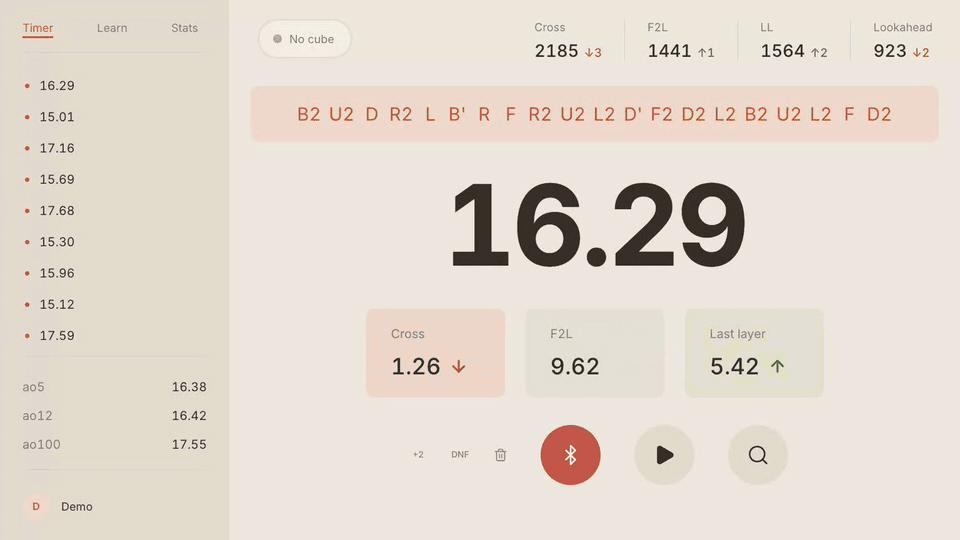
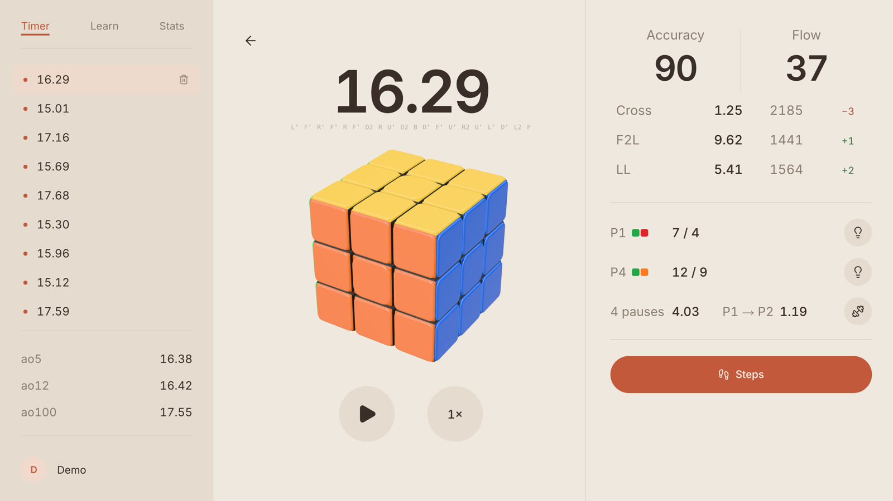
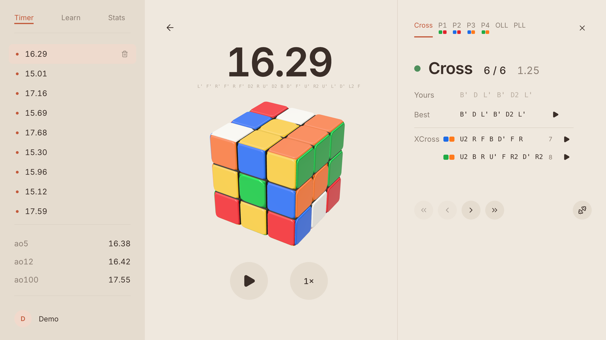
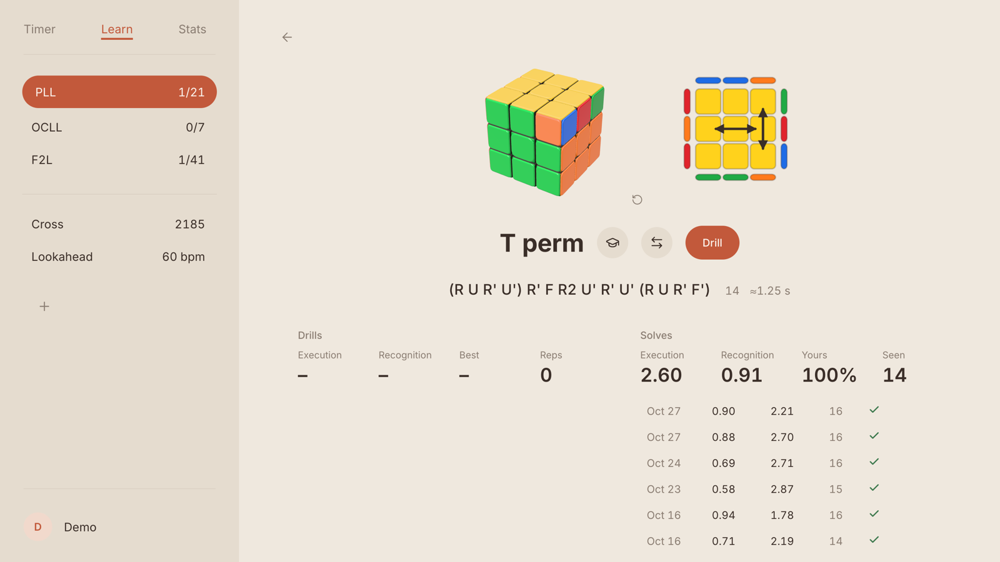
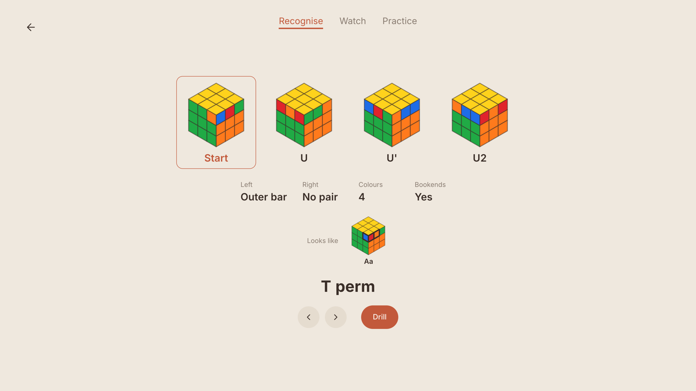
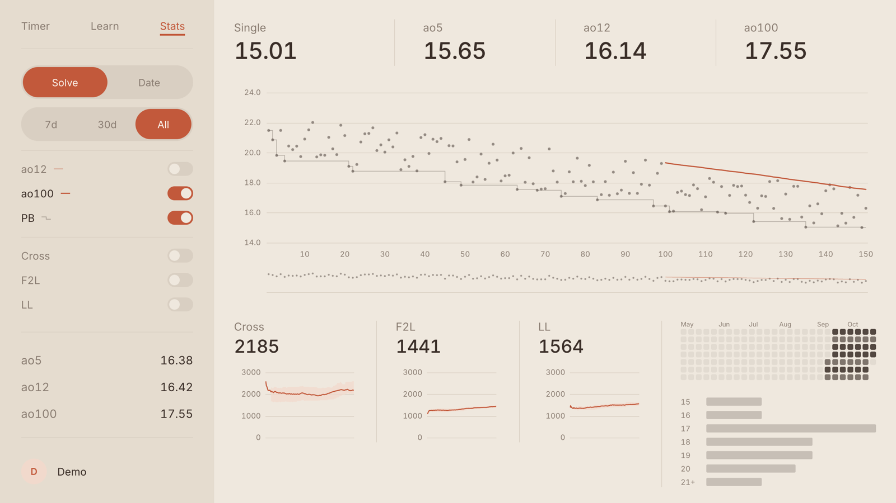

# Cube trainer

I made this to get better at cubing. It connects to a smart cube over Bluetooth, watches every turn of every solve,
and tells me where the time actually went. Then it gives me drills for exactly those things.

It's live at **[cube.nathanwei.org](https://cube.nathanwei.org)**.

That's the Test button, which plays a demo solve so you can try everything without a cube in your hands.

## How I got into Bluetooth cubes

I was buying a new cube anyway, so first I looked into whether a smart cube was worth it.

What sold me was how much one knows. A smart cube reports every turn the moment it happens, so a solve stops being
a single number. You can split it into the cross, each F2L pair and the last layer without pressing anything. You can
see how long you spent recognising a case versus actually doing it, find every spot where you stopped to look, and
tell which case came up and which alg you used. Without the cube, getting any of that means tapping keys mid-solve or
going through a video frame by frame.

So I got one. The first version of this site was a normal keyboard timer with a virtual cube. Once the smart cube
was connected, I deleted both. Everything here is built around knowing every move.

## How I think about practice

- **Pauses are what make you slow.** Most of the gap between a decent solver and a fast one is time spent standing
  still looking for the next piece, not slow fingers or missing algorithms. So the app measures pauses everywhere,
  and lookahead gets its own drill.
- **Slow and correct is still a miss.** Knowing an alg isn't the same as having it. A drill rep only counts if it's
  quick, because the point is to stop pausing, not to remember it eventually.
- **Only real solves count.** Drills are practice. Your ratings only move when you do real solves, since that's the
  thing you're actually trying to get better at.
- **Every weakness should lead to a drill.** "Your F2L was slow" isn't useful on its own. Every stage of a solve
  review links straight to practising that exact thing.
- **Learn what people actually use.** The recommended alg for a case is what top solvers use now, then J Perm's
  pick, then the community favourite, not whatever happens to be shortest.
- **Labels and numbers, no paragraphs.** No explanatory text on screen, and it has to look good. A messy screen
  reads as broken.

## What it does

### Timer

- Gives you a scramble and follows along as you apply it, fading the moves you've done. If you slip, it shows how
  to get back.
- Starts on your first turn and stops when the cube is solved. Inspection is optional.
- Splits every solve into the cross, each F2L pair and the last layer, with no button presses.
- Keeps a rating for your cross, F2L, last layer and lookahead, so you can see which part is holding you back.

### Solve review

  
  

Like chess.com's Game Review, but for a solve.

- **Accuracy** is how close your cross and F2L were to the fewest moves possible. **Flow** is how much of the solve
  you spent turning instead of paused.
- Every stage gets a time and a rating, and each F2L pair shows your move count next to the best.
- Step through the solve one stage at a time, with your moves next to the best ones, played out on a 3D cube.
- Each stage has a button that drills exactly that: the cross, that F2L case, or that last-layer case.

### Learn

  
  

Pick what you're working on from PLL, OLL, OCLL, COLL, EPLL, EO and F2L, plus cross, xcross and lookahead drills.

- Spaced repetition decides what to practise each day, and slow reps count as misses.
- Drill scrambles look like normal scrambles, so you can't spot the case from the scramble.
- **Learning a new alg:** see the case from every angle along with what to look for, watch it done, then do it on
  your own cube while the app checks each turn. The hints fade until you're doing it from memory, and three clean
  reps makes it learnt.
- Every case shows your alg, the recommended one and the alternatives, each with an estimate of how fast it is to
  turn. *Record mine* saves the way you actually do it.
- **Cross trainer:** the scrambles get harder when you find near-optimal crosses and easier when you don't.
- **Lookahead:** solve to a metronome. Pausing, or spinning U to buy time, counts against you. Three clean solves in
  a row and the tempo goes up.

### Stats

Every solve with ao12, ao100 and PB lines, a rating history for each part of the solve, a practice calendar, and a
histogram.

### Also

- The cube on screen tilts with the one in your hands.
- Choose OLL/PLL or EO/COLL/EPLL for your last layer, and solves are split and reviewed that way.
- Sign in with Google and everything syncs. Solves done offline upload when you're back.

## What you need

A GAN smart cube (12 ui, 14 ui, 16 ui Max, i4, i Carry 2 or S) or a MoYu AI 2023, and Chrome or Edge on a computer.
Brave works after turning on `brave://flags/#brave-web-bluetooth-api`. Safari and Firefox can't connect to Bluetooth
cubes.

## Thanks

The case algorithms come from [cubingapp](https://github.com/spencerchubb/cubingapp) and
[Cubedex](https://github.com/poliva/cubedex), and the Bluetooth connection is built on
[smartcube-web-bluetooth](https://github.com/poliva/smartcube-web-bluetooth). Alg recommendations lean on
[J Perm](https://jperm.net/algs), [SpeedcubeQuest](https://speedcube.quest), [reco.nz](https://reco.nz) and
[SpeedCubeDB](https://www.speedcubedb.com).
